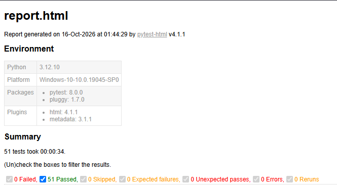

# QA Automation Portfolio

Портфолио автотестов на Python. Демонстрирует навыки написания тестов для API, UI, БД и сетевых приложений.

## 🛠 Технологии

- **Язык:** Python 3.12
- **Фреймворк:** pytest
- **API:** requests
- **UI:** Selenium, Page Object, webdriver-manager
- **БД:** SQLite
- **Сеть:** socket, threading
- **Отчёты:** pytest-html

## 📂 Проекты

| № | Проект | Что демонстрирует | Стек |
|---|---|---|---|
| 1 | [API-тесты](01_api_tests/) | GET/POST/PUT/DELETE, статус-коды, JSON | requests, pytest |
| 2 | [UI-тесты](02_ui_tests/) | Логин, Page Object, ожидания | Selenium, pytest |
| 3 | [TCP-тесты](03_tcp_socket_tests/) | Сокеты, автозапуск сервиса, JSON | socket, pytest |
| 4 | [Юнит-тесты](04_unit_tests/) | Параметризация, границы, исключения | pytest |
| 5 | [Тесты БД](05_telegram_bot_tests/) | CRUD, UNIQUE, поиск | sqlite3, pytest |

## 📊 Результаты

Все 51 тест проходят за ~65 секунд.



## 🚀 Как запустить

```bash
git clone https://github.com/Yumeno3051/qa-automation-portfolio.git
cd qa-automation-portfolio
python -m venv .venv
.venv\Scripts\activate    # Windows
pip install -r requirements.txt
pytest -v
